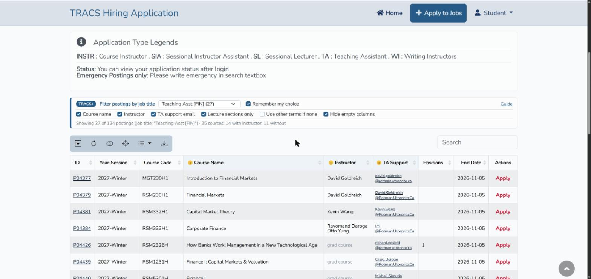
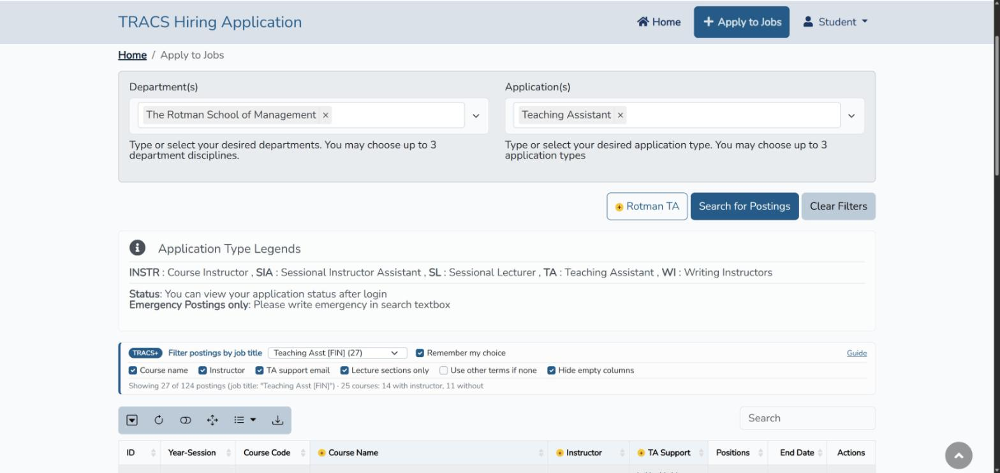
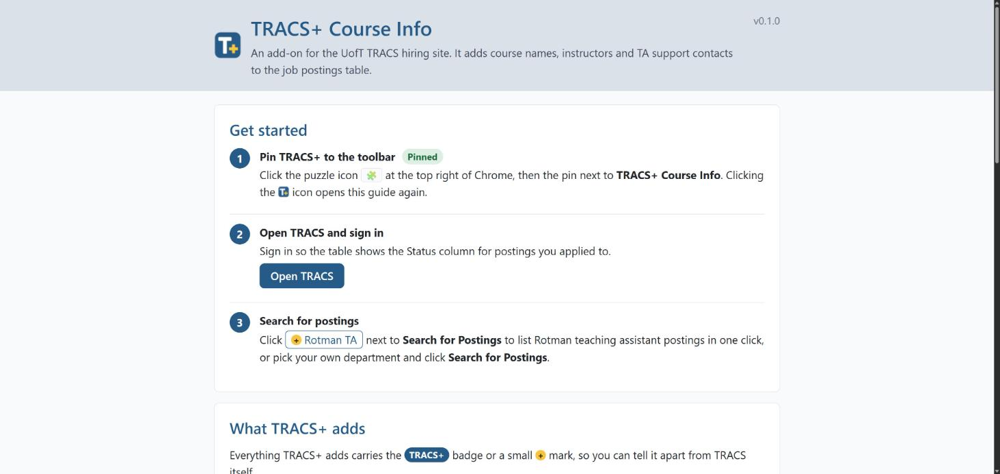

# TRACS+ Course Info

An unofficial Chrome extension for [TRACS](https://tracs.utoronto.ca/), the University of Toronto's TA and instructor hiring site. It shows what each job posting is about (course name, instructor, contact) right in the postings table, so you no longer have to open every posting.

Everything TRACS+ adds uses TRACS's own colors and carries a blue **TRACS+** badge or a gold **+** mark, so you can tell it apart from the site itself.

## Features

**New columns**
- **Course Name**: hover over it for the course description.
- **Instructor**: from the public UofT Timetable Builder for the posting's term; courses with several instructors list each one. Hover over it for each section's instructor.
- **TA Support**: the posting's contact email as a clickable link.

**The TRACS+ bar above the table**
- **Filter postings by job title**: a dropdown of the job titles in your results with their counts, such as `Teaching Asst [FIN] (27)`. **Remember my choice** reopens with the same title next time.
- **Checkboxes**: show or hide each new column, use lecture instructors only, fall back to another term's instructors, and hide empty columns.
- **Counts**: postings listed, and how many courses have a known instructor.

**A tidier table**
- Every posting is on one page, and postings you already submitted stay at the top.
- Columns that are blank for every listed posting are hidden (Hours too), and so is Dept-App when every posting shares one.
- **Apply** links are red.

**One-click Rotman search**

The **+ Rotman TA** button, next to Search for Postings, searches Rotman teaching assistant postings in one click.

**Application form notes**

Short TRACS+ notes explain the "anticipated convocation date" question and the "best candidate" question. TRACS+ fills the required "best candidate" field with "." only when it is empty. Nothing is saved until you click Next.

**Built-in guide**

The guide opens once after you install TRACS+. Click the toolbar icon, or **Guide** in the TRACS+ bar, to open it again.

## What the Instructor cell means

| Cell | Meaning |
| --- | --- |
| Names | Instructors in the timetable for the posting's term (in italics: taken from another term) |
| `TBA` | The course is in the timetable, but no instructor is posted yet |
| `grad course` | Graduate courses (4-digit codes such as RSM2512H) are not in the public timetable |
| `not in timetable` | The timetable does not list this course code |

## Install

- **Chrome Web Store**: search for "TRACS+ Course Info" once the listing is approved.
- **From source**: download this repo, open `chrome://extensions`, turn on **Developer mode**, click **Load unpacked** and choose the folder.

## Privacy

TRACS+ runs only on tracs.utoronto.ca. It sends course codes, and nothing about you, to the public UofT Timetable Builder API. It has no analytics and no servers of its own. See [PRIVACY.md](PRIVACY.md).

## Development

| Command | What it does |
| --- | --- |
| `node --test "test/*.test.js"` | Unit tests for the parsing and matching logic (`src/lib.js`) |
| `node dev/watch.js` | Hot reload: unpacked installs reload themselves and the TRACS postings tab whenever a file changes |
| `node dev/build.js` | Store package without the dev reload: `dist/tracs-plus/` and `dist/tracs-plus-<version>.zip` |
| `node dev/make-icons.js` | Redraws the toolbar icons in `icons/` |

How it works: `src/main.js` runs in the page and adds the columns through bootstrap-table's own `refreshOptions`, so sorting, search and export include them. `src/background.js` queries the Timetable Builder (the page cannot, because of CORS), caches results for a day, and sets the `Origin` header the API expects on its own requests only. `src/bridge.js` passes messages and settings between the two.

TRACS+ is not affiliated with or endorsed by the University of Toronto.
